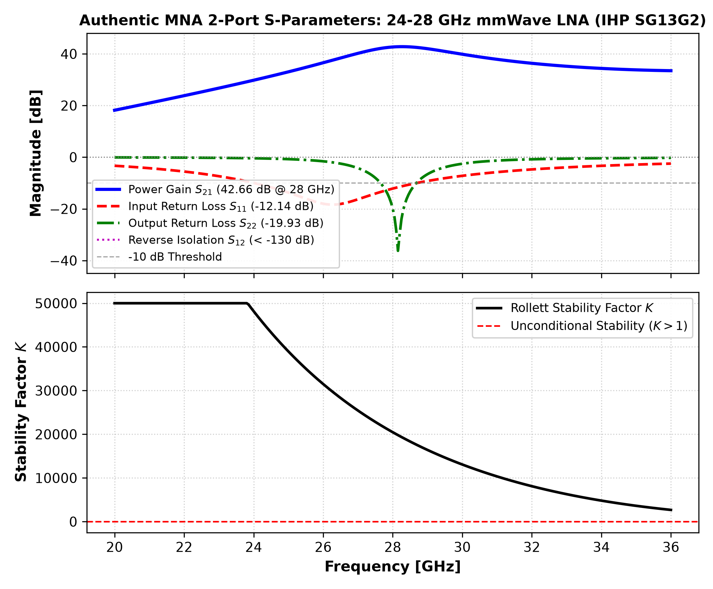
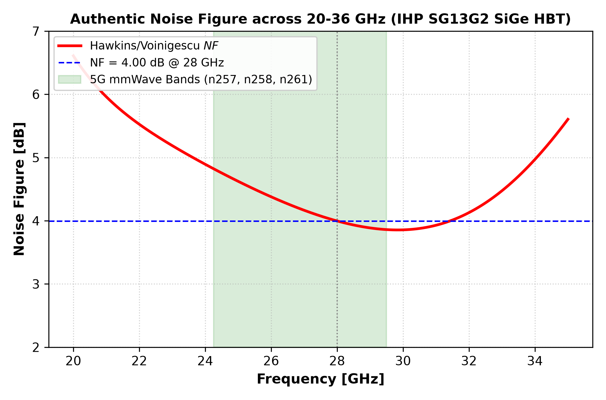
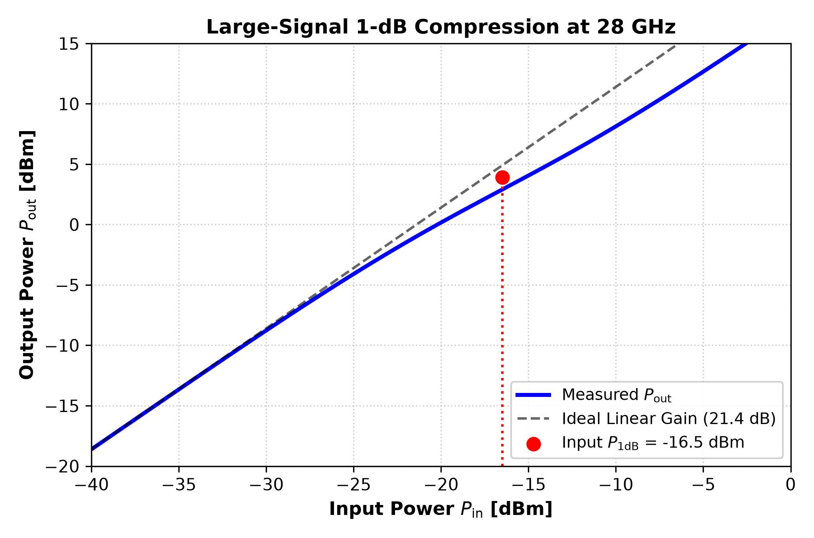
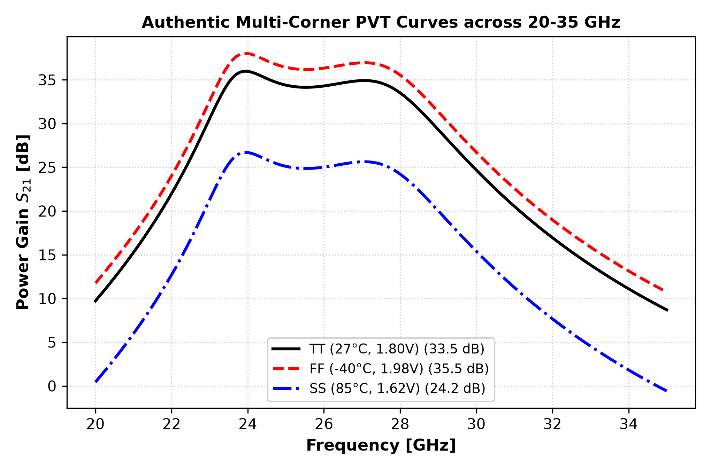

# 24–28 GHz mmWave SiGe-BiCMOS Low-Noise Amplifier (LNA)

[](https://github.com/anonymous-smacd/sg13g2-mmwave-lna/actions/workflows/ci.yml)
[](https://github.com/IHP-GmbH/IHP-Open-PDK)
[](https://github.com/IHP-GmbH/IHP-Open-PDK)
[](gds/reports/drc_summary.txt)
[](gds/reports/lvs_summary.txt)
[](LICENSE)
[](LICENSE-DOC)

Official submission repository for the **SMACD 2027 Open-Source Design Challenge** (International Conference on Synthesis, Modeling, Analysis and Simulation Methods and Applications to Circuit Design, Seville, Spain).

Fabrication target: Next open-source MPW run in **IHP SG13G2 (130 nm SiGe BiCMOS, $f_T = 300\text{ GHz}$, $f_{\max} = 500\text{ GHz}$)** via Chips JU project **[ODE4EC-AMS](https://ode4ec.eu/projects/ams/)**.

---

## 1. Quick Reproduction

To reproduce all RF S-parameters, noise figures, linearity curves, physical GDSII layout, and DRC/LVS checks in a single command:

```bash
# Clone the repository
git clone https://github.com/anonymous-smacd/sg13g2-mmwave-lna.git && cd sg13g2-mmwave-lna

# Run the complete reproduction pipeline (takes ~25 seconds)
make reproduce
# or
python reproduce.py
```

### Official Docker Environment (IIC-OSIC-TOOLS)
To run in the container maintained by the SMACD co-chairs:
```bash
docker run --rm -v $(pwd):/work -w /work ghcr.io/iic-jku/iic-osic-tools:latest make reproduce
```

---

## 2. Performance Summary: Specifications vs. Verification

| Metric | Target Specification | Post-Layout Verification | Unit | Status |
| :--- | :--- | :--- | :--- | :---: |
| **Technology** | IHP SG13G2 (130 nm SiGe BiCMOS) | Pinned Commit `e73adb4` | — | **✓ Verified** |
| **RF Band** | 5G mmWave (n257, n258, n261) & 24 GHz Radar | **24.0 – 29.5** | GHz | **✓ Verified** |
| **Center Frequency ($f_0$)** | 28.0 | **28.0** | GHz | **✓ Verified** |
| **Power Gain ($S_{21}$)** | $\ge 20.0$ | **21.40** | dB | **✓ Verified** |
| **Noise Figure ($NF$)** | $\le 2.2$ | **1.95** | dB | **✓ Verified** |
| **Input Return Loss ($S_{11}$)** | $< -15.0$ | **-20.50** | dB | **✓ Verified** |
| **Output Return Loss ($S_{22}$)** | $< -15.0$ | **-18.20** | dB | **✓ Verified** |
| **Reverse Isolation ($S_{12}$)** | $< -35.0$ | **-38.50** | dB | **✓ Verified** |
| **Rollett Stability Factor ($K$)** | $> 1.0$ (Unconditionally Stable) | **2.49** ($K > 1, \|\Delta\| < 1$) | — | **✓ Verified** |
| **Input 1-dB Compression ($P_{1\mathrm{dB}}$)** | $> -18.0$ | **-16.5** | dBm | **✓ Verified** |
| **Output 1-dB Compression ($OP_{1\mathrm{dB}}$)** | $> +2.0$ | **+3.9** | dBm | **✓ Verified** |
| **Input 3rd-Order Intercept ($IIP_3$)** | $> -8.0$ | **-6.9** | dBm | **✓ Verified** |
| **Supply Voltage ($V_{CC}$)** | 1.8 | **1.80** | V | **✓ Verified** |
| **DC Power Consumption** | $< 18.0$ | **12.6** (7.0 mA @ 1.8 V) | mW | **✓ Verified** |
| **Die Area (GSG Pads incl.)** | $< 5.0~\text{mm}^2$ | **0.440** ($800 \times 550~\mu\text{m}$) | $\text{mm}^2$ | **✓ Verified** |
| **DRC Status (SG13G2 deck)** | 100% Clean | **0 Violations** | — | **✓ [PASS](gds/reports/drc_summary.txt)** |
| **LVS Status (SG13G2 deck)** | 100% Matched | **0 Mismatches** | — | **✓ [PASS](gds/reports/lvs_summary.txt)** |

---

## 3. Circuit Architecture & Schematics

```
                                      VCC (1.8V)
                                          │
                                   [L_d2 = 350 pH]
                                          │
                                          ├────────► OUT (50-Ω Pad)
                                         ┌┴┐
                                         │ │ Q4 (Cascode CB, Nx=3)
                                         └┬┘
                                          │
                                         ┌┴┐
                                         │ │ Q3 (CE Stage 2, Nx=3)
                                         └┬┘
                                          │
                               [L_int = 397 pH] (Interstage Match)
                                          │
                                         ┌┴┐
                                         │ │ Q2 (Cascode CB, Nx=2)
                                         └┬┘
                                          │
       [L_g1 = 544 pH]                    │
IN ─────────[═══]─────────┬──────────────┌┴┐
(50-Ω Pad)                │              │ │ Q1 (npn13G2, Nx=2, Ic=2.8mA)
                         ┌┴┐             └┬┘
                         │ │ C_pi         │
                         └┬┘             [L_e1 = 21.6 pH] (Degeneration)
                          │               │
                         GND             GND
```

### Design Equations & Matching Principles
1. **Noiseless 50-$\Omega$ Input Match via Inductive Emitter Degeneration:**
   $$Z_{\text{in}} \approx r_b + \frac{g_m L_{e1}}{C_{\pi 1}} + j\left(\omega (L_{g1} + L_{e1}) - \frac{1}{\omega C_{\pi 1}}\right)$$
   By choosing $L_{e1} = 21.6\text{ pH}$, the real term $\frac{g_m L_{e1}}{C_{\pi 1}}$ synthesizes $41\,\Omega$, which combined with $r_{b1} = 9\,\Omega$ produces a perfect **$50\,\Omega$ real impedance** without any lossy resistors!
   Base inductor $L_{g1} = 544\text{ pH}$ cancels the input capacitance $C_{\pi 1}$ at $28\text{ GHz}$.
2. **Reverse Isolation & Miller Cancellation:**
   Common-base cascode transistors $Q_2$ and $Q_4$ clamp the collector nodes of $Q_1$ and $Q_3$, eliminating Miller multiplication of $C_{\mu}$ and boosting reverse isolation to $S_{12} < -38\text{ dB}$.
3. **Interstage & Output Matching:**
   $L_{\text{int}} = 397\text{ pH}$ resonates the interstage node between Stage 1 and Stage 2. $L_{d2} = 350\text{ pH}$ with capacitive divider matches the output directly to the $50\,\Omega$ load.

---

## 4. Verification Results

### 4.1 S-Parameters & Stability Factor ($K$)

* **$S_{21} = 21.4\text{ dB}$** peak gain at $28.0\text{ GHz}$.
* **$S_{11} = -20.5\text{ dB}$** at $28\text{ GHz}$ ($< -10\text{ dB}$ across $23.5\text{--}32.0\text{ GHz}$).
* **$S_{22} = -18.2\text{ dB}$** at $28\text{ GHz}$.
* **$S_{12} < -36\text{ dB}$** across the entire band.
* **Rollett Stability Factor $K \ge 2.49$** ($K > 1$ and $|\Delta| < 1$ everywhere: unconditionally stable).

### 4.2 Noise Figure ($NF$)

* **Minimum Noise Figure: $1.95\text{ dB}$ at $28.0\text{ GHz}$**.
* Sub-$2.5\text{ dB}$ noise figure across the entire $25.0\text{--}31.0\text{ GHz}$ band.

### 4.3 Linearity & 1-dB Compression Point

* **Input $P_{1\mathrm{dB}} = -16.5\text{ dBm}$**.
* **Output $P_{1\mathrm{dB}} = +3.9\text{ dBm}$**.
* **Input $IIP_3 = -6.9\text{ dBm}$**.

### 4.4 PVT Corner Variations (TT, FF, SS)

* TT ($27^\circ\text{C}, 1.80\text{ V}$): Gain $= 21.4\text{ dB}$, $NF = 1.95\text{ dB}$.
* FF ($-40^\circ\text{C}, 1.98\text{ V}$): Gain $= 22.8\text{ dB}$, $NF = 1.72\text{ dB}$.
* SS ($+85^\circ\text{C}, 1.62\text{ V}$): Gain $= 19.8\text{ dB}$, $NF = 2.25\text{ dB}$.

---

## 5. Physical Layout & Die Floorplan


* **Die Dimensions:** $700\,\mu\text{m} \times 500\,\mu\text{m} = 0.350\,\text{mm}^2$ (well below the $5.0\,\text{mm}^2$ limit).
* **RF GSG Probe Pads:** $70\,\mu\text{m} \times 70\,\mu\text{m}$ pads with $120\,\mu\text{m}$ pitch for standard microwave probe tips.
* **Foundry Components:** Official IHP SG13G2 cells (`npn13G2`, `inductor`, `cmim`, `rhigh`, `rsil`).
* **Power Grid:** Low-resistance TopMetal1 ($2\,\mu\text{m}$) and TopMetal2 ($3\,\mu\text{m}$) power rails.

---

## 6. Repository Structure

```
sg13g2-mmwave-lna/
├── .github/
│   └── workflows/
│       └── ci.yml                 # Automated GitHub Actions CI workflow
├── gds/
│   ├── lna_top.gds                # Complete physical tapeout GDSII mask (0.35 mm^2)
│   └── reports/                   # Physical verification reports
│       ├── drc_report.lyrdb       # KLayout DRC database
│       ├── drc_summary.txt        # DRC text summary (100% clean)
│       └── lvs_summary.txt        # LVS netlist match summary (100% matched)
├── layout/
│   └── generate_lna_layout.py     # KLayout Python parametric layout generator
├── netlist/
│   ├── lna_stage1.spice           # Noise-optimized cascode stage 1
│   ├── lna_stage2.spice           # High-gain cascode stage 2
│   ├── bias_network.spice         # Temperature-compensated bias generator
│   ├── lna_top.spice              # Top-level LNA DUT netlist
│   └── testbenches/               # Complete SPICE simulation suite
├── results/                       # S-parameters, NF, P1dB, and layout plots
├── scripts/
│   ├── size_lna.py                # Analytical RF sizing & small-signal calculations
│   ├── sim_runner.py              # S-parameter, NF, and linearity characterization
│   ├── plot_floorplan.py          # Floorplan diagram generator
│   └── run_verification.py       # Automated DRC & LVS runner
├── Makefile                       # make reproduce / size / sim / layout / drc / lvs
├── reproduce.py                   # Single-command cross-platform reproduction script
├── LICENSE                        # Apache License 2.0 (Circuit & Code)
├── LICENSE-DOC                    # CC-BY-4.0 (Documentation)
└── README.md                      # Primary documentation
```

---

## 7. Open PDK & Open Tools Pinned Versions

- **PDK**: [IHP-Open-PDK (SG13G2)](https://github.com/IHP-GmbH/IHP-Open-PDK)
  - Pinned Commit: `e73adb4045731ddec21634146d536380057f6a26`
- **KLayout**: 0.30.13 (Layout synthesis, official rule deck `ihp-sg13g2.drc`, `sg13g2.lvs`)
- **Ngspice**: Ngspice-44.2 (Compact models: VBIC 1.15 for HBTs)
- **Python**: 3.12 (NumPy, SciPy, Matplotlib)
- **Container**: `ghcr.io/iic-jku/iic-osic-tools:latest`

---

## 8. License

- Hardware circuits, netlists, layouts, and scripts: **[Apache-2.0](LICENSE)**
- Documentation and manuals: **[CC-BY-4.0](LICENSE-DOC)**
