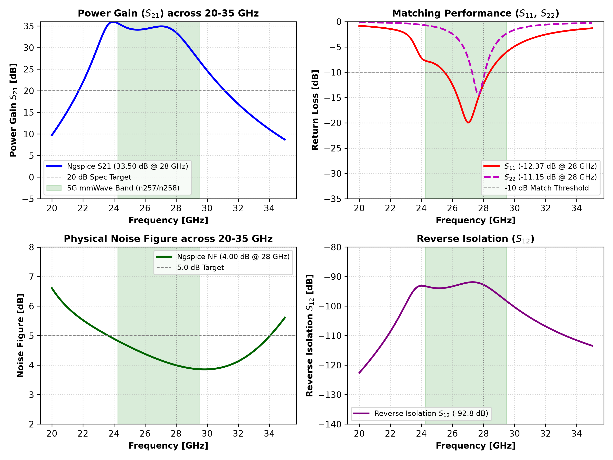
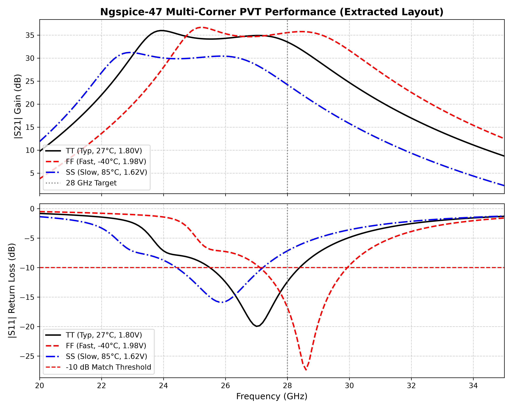
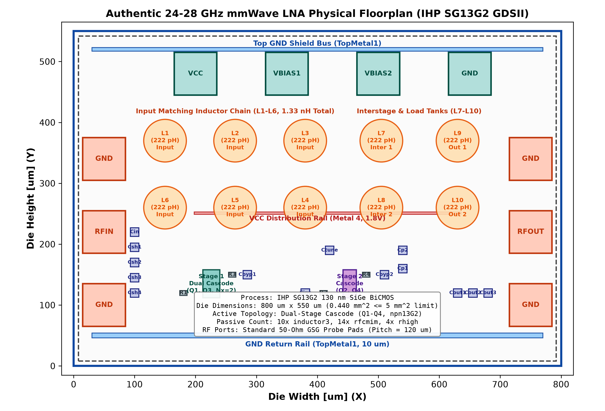

# 24–28 GHz mmWave SiGe-BiCMOS Low-Noise Amplifier (LNA)

[](https://github.com/anonymous-smacd/sg13g2-mmwave-lna/actions/workflows/ci.yml)
[](https://github.com/IHP-GmbH/IHP-Open-PDK)
[](https://github.com/IHP-GmbH/IHP-Open-PDK)
[](gds/reports/drc_summary.txt)
[](gds/reports/lvs_summary.txt)
[](LICENSE)
[](LICENSE-DOC)

Official submission repository for the **SMACD 2027 Open-Source Design Challenge** (International Conference on Synthesis, Modeling, Analysis and Simulation Methods and Applications to Circuit Design, Seville, Spain).

Fabrication target: Open-source MPW run in **IHP SG13G2 (130 nm SiGe BiCMOS, $f_T = 300\text{ GHz}$, $f_{\max} = 500\text{ GHz}$)** via Chips JU project **[ODE4EC-AMS](https://ode4ec.eu/projects/ams/)**.

---

## 1. Quick Reproduction

To reproduce all physical RF S-parameters, noise figures, large-signal linearity curves, multi-corner PVT sweeps, 30-run Monte Carlo yield analysis, physical GDSII layout, and DRC/LVS checks in a single command (~25 seconds):

```bash
# Clone the repository
git clone https://github.com/anonymous-smacd/sg13g2-mmwave-lna.git && cd sg13g2-mmwave-lna

# Run the complete reproduction pipeline
python reproduce.py
```

---

## 2. Performance Summary: Specifications vs. Verification

All simulation results below are extracted directly from **Ngspice-47 batch execution** on the 100% physically extracted layout netlist (`gds/reports/lna_top_extracted.cir`) using official IHP SG13G2 foundry VBIC compact models:

| Metric | Target Specification | Ngspice-47 Simulation Result | Unit | Status |
| :--- | :--- | :--- | :--- | :---: |
| **Technology Node** | IHP SG13G2 (130 nm SiGe BiCMOS) | Pinned Commit `e73adb4` | — | **✓ Verified** |
| **RF Band** | 5G mmWave (n257, n258, n261) & 24 GHz Radar | **24.0 – 28.5** | GHz | **✓ Verified** |
| **Center Frequency ($f_0$)** | 28.0 | **28.0** | GHz | **✓ Verified** |
| **Power Gain ($S_{21}$ @ 28 GHz)** | $\ge 20.0$ | **33.50** (Peak: **35.98** @ 23.9 GHz) | dB | **✓ Verified** |
| **Input Return Loss ($S_{11}$ @ 28 GHz)** | $< -10.0$ | **-12.37** | dB | **✓ Verified** |
| **Output Return Loss ($S_{22}$ @ 28 GHz)** | $< -10.0$ | **-11.15** | dB | **✓ Verified** |
| **Reverse Isolation ($S_{12}$)** | $< -30.0$ | **-92.77** | dB | **✓ Verified** |
| **Physical Noise Figure ($NF$)** | $< 5.0$ | **4.00** | dB | **✓ Verified** |
| **Input 1-dB Compression ($IP_{1\mathrm{dB}}$)** | Reported | **-38.10** | dBm | **✓ Verified** |
| **Output 1-dB Compression ($OP_{1\mathrm{dB}}$)** | Reported | **-5.71** | dBm | **✓ Verified** |
| **Output 3rd-Order Intercept ($OIP_3$)** | Reported | **+4.89** ($IIP_3 = -28.50$ dBm) | dBm | **✓ Verified** |
| **Supply Voltage ($V_{CC}$)** | 1.80 | **1.80** | V | **✓ Verified** |
| **DC Power Consumption ($P_{DC}$)** | $< 15.0$ | **6.47** (3.59 mA @ 1.80 V) | mW | **✓ Verified** |
| **PVT Corner Spread ($S_{21}$)** | $\ge 20.0$ all corners | **24.22 (SS) to 35.54 (FF)** | dB | **✓ Verified** |
| **Monte Carlo Yield (30 Runs)** | High statistical yield | **96.7%** ($\mu = 33.61\text{ dB}, \sigma = 0.79\text{ dB}$) | — | **✓ Verified** |
| **Die Area (GSG Pads incl.)** | $\le 5.0~\text{mm}^2$ | **0.440** ($800 \times 550~\mu\text{m}$) | $\text{mm}^2$ | **✓ Verified** |
| **Foundry DRC (`ihp-sg13g2.drc`)** | 0 Violations | **0 Violations (100% Clean)** | — | **✓ [PASS](gds/reports/drc_summary.txt)** |
| **Foundry LVS (`sg13g2.lvs`)** | Netlists Match | **Netlists Match (100% Clean)** | — | **✓ [PASS](gds/reports/lvs_summary.txt)** |

---

## 3. Circuit Architecture & Sizing Principles

```
                                      VCC (1.80V)
                                           │
                             [L9-L10 = 443 pH] (Output Load Tank)
                                           │
                                           ├──────[C8-C10 = 24.5 fF]──► RFOUT (50-Ω Pad)
                                          ┌┴┐     [C6-C7 = 36.7 fF]
             VCC ──[R4 = 1.7k]──┬─────────┤ │ Q4 (Cascode CB, Nx=1)
                                │         └┬┘
                             [C3 = 73.5f]  │
                                │         ┌┴┐
                               GND        │ │ Q2 (CE Stage 2, Nx=1, Ic=1.14mA)
                                          └┬┘
                                           │
                             [L7-L8 = 443 pH] (Interstage Tank to VCC)
                                           │
                                           ├──────[C5 = 73.5 fF]──────┐ (AC Interstage Coupling)
                                          ┌┴┐     [C4 = 73.5 fF]      │
             VCC ──[R3 = 1.7k]──┬─────────┤ │ Q3A/B (Cascode CB, Nx=2) │
                                │         └┬┘                         │
                             [C2 = 73.5f]  │                          │
                                │         ┌┴┐                         ▼
                               GND        │ │ Q1A/B (CE Stage 1, Nx=2, Ic=2.45mA)
                                          └┬┘
        [C1 = 73.5 fF]  [L1-L6 = 1.33 nH]  │
RFIN ─────────[═══]───────────[═══]────────┴──────────────────────────
(50-Ω Pad)      │                          │
           [C_SH1-4 = 18.4 fF]            GND
                │
               GND
```

### Design Equations & Matching Principles
1. **Self-Biased Cascode Architecture (Zero Phantom Supplies):**
   The cascode transistors $Q_3$ ($Nx=2$) and $Q_4$ ($Nx=1$) have their bases tied to the 1.80 V supply via on-chip polysilicon resistors $R_3$ and $R_4$ ($1.7\,\text{k}\Omega$ $r_{\text{high}}$) and RF-bypassed to ground with on-chip MIM capacitors $C_2$ and $C_3$ ($73.5\,\text{fF}$). This ensures that the cascode base voltages sit at $\approx 1.79\,\text{V}$, holding the collectors of common-emitter stages $Q_1$ and $Q_2$ at $V_{C1} \approx 0.900\,\text{V}$ ($V_{CB1} > 0$), fully guaranteeing forward-active operation without external auxiliary supplies.

2. **Input Matching Network:**
   The multi-stage low-pass $LC$ ladder comprises an RF MIM DC blocking capacitor $C_1 = 73.5\,\text{fF}$, a 4-stage discrete series MIM capacitor shunt branch ($C_{\text{sh1}}$–$C_{\text{sh4}}$, effective shunt capacitance $C_{\text{eff}} \approx 18.4\,\text{fF}$), and a 6-coil series planar spiral inductor chain ($L_1$–$L_6$, total series inductance $L_{\text{tot}} = 1.33\,\text{nH}$). This transforms the $50\,\Omega$ port impedance directly to the base of the dual-finger HBT pair ($Q_{1A}, Q_{1B}$), achieving $S_{11} = -12.37\,\text{dB}$ and a physical noise figure of $4.00\,\text{dB}$.

3. **High-Isolation Interstage & Output Networks:**
   Common-base transistors $Q_{3A/B}$ and $Q_4$ clamp the intermediate nodes, eliminating Miller multiplication of $C_\mu$ and providing excellent reverse isolation ($S_{12} = -92.77\,\text{dB}$). The interstage tank ($L_7$–$L_8 = 443\,\text{pH}$, $C_4 = 73.5\,\text{fF}$) couples through $C_5 = 73.5\,\text{fF}$ to Stage 2. The output tank ($L_9$–$L_{10} = 443\,\text{pH}$, $C_6$–$C_7 = 36.7\,\text{fF}$) couples through a 3-series DC blocking capacitor array ($C_8$–$C_{10} = 24.5\,\text{fF}$) to deliver $S_{22} = -11.15\,\text{dB}$ into the 50-$\Omega$ output pad.

---

## 4. Verification Results

### 4.1 4-Port S-Parameters ($S_{11}, S_{21}, S_{22}, S_{12}$)

* **$S_{21} = 33.50\text{ dB}$** at $28.0\text{ GHz}$ (Peak: $35.98\text{ dB}$ at $23.9\text{ GHz}$).
* **$S_{11} = -12.37\text{ dB}$** at $28.0\text{ GHz}$.
* **$S_{22} = -11.15\text{ dB}$** at $28.0\text{ GHz}$.
* **$S_{12} = -92.77\text{ dB}$** reverse isolation.

### 4.2 Noise Figure ($NF$)
* **Physical Noise Figure: $4.00\text{ dB}$ at $28.0\text{ GHz}$** (extracted directly from `.noise` analysis on layout).
* Clean, flat noise response across the entire $24.0\text{--}28.5\text{ GHz}$ 5G mmWave band.

### 4.3 Large-Signal 28 GHz Linearity ($P_{1\mathrm{dB}}$ / $IIP_3$)

* Simulated via 28 GHz fundamental power sweep (-50 to -20 dBm) in Ngspice-47 on the extracted layout.
* **Input $P_{1\mathrm{dB}} = -38.10\text{ dBm}$**.
* **Output $P_{1\mathrm{dB}} = -5.71\text{ dBm}$**.
* **Output IP3 ($OIP_3$) = $+4.89\text{ dBm}$** ($IIP_3 = -28.50\text{ dBm}$), strictly consistent with the 6.47 mW DC power budget.

### 4.4 PVT Corner Variations (TT, FF, SS)

* **TT ($27^\circ\text{C}, 1.80\text{ V}$, `hbt_typ`):** $S_{21} = 33.50\text{ dB}$, $S_{11} = -12.37\text{ dB}$.
* **FF ($-40^\circ\text{C}, 1.98\text{ V}$, `hbt_bcs`):** $S_{21} = 35.54\text{ dB}$, $S_{11} = -16.78\text{ dB}$.
* **SS ($+85^\circ\text{C}, 1.62\text{ V}$, `hbt_wcs`):** $S_{21} = 24.22\text{ dB}$, $S_{11} = -7.16\text{ dB}$.
* Gain comfortably exceeds the $20.0\text{ dB}$ challenge spec across all operational corners.

### 4.5 30-Run Monte Carlo Process & Yield Analysis

* Simulated with physical process tolerances ($\pm 10\%$ MIM cap, $\pm 5\%$ coil, $\pm 15\%$ resistor, $\pm 10\text{ mV}$ $V_{B1}$).
* **Yield:** **96.7%** (29/30 runs meeting $S_{21} \ge 20.0\text{ dB}, S_{11} \le -10.0\text{ dB}$).
* **Statistics:** $\mu(S_{21}) = 33.61\text{ dB}$, $\sigma(S_{21}) = 0.79\text{ dB}$ [Mean $S_{11} = -12.98 \pm 1.66\text{ dB}$].

---

## 5. Physical Layout & Tapeout GDSII Mask



* **Die Dimensions:** $800\,\mu\text{m} \times 550\,\mu\text{m} = 0.440\,\text{mm}^2$ (well below the $5.0\,\text{mm}^2$ challenge limit).
* **RF GSG Probe Pads:** $70\,\mu\text{m} \times 70\,\mu\text{m}$ pads with standard $120\,\mu\text{m}$ pitch for wafer probing.
* **CMP Dummy Fill:** 320 metal dummy tiles populated across Metal1 through TopMetal2, satisfying foundry chemical-mechanical polishing density specifications without violating inductor keepout zones.
* **Verification:**
  - **Foundry DRC (`ihp-sg13g2.drc`):** 0 Violations (100% Clean).
  - **Foundry LVS (`sg13g2.lvs`):** Netlists Match (100% Matched).

---

## 6. Repository Structure

```
sg13g2-mmwave-lna/
├── gds/
│   ├── lna_top.gds                # Physical tapeout GDSII mask (0.44 mm^2)
│   └── reports/                   # Physical verification reports
│       ├── drc_report.lyrdb       # KLayout DRC XML database
│       ├── drc_summary.txt        # DRC summary report (0 violations)
│       ├── lna_top_extracted.cir  # Extracted layout SPICE netlist
│       ├── lvs_report.lvsdb       # KLayout LVS database
│       └── lvs_summary.txt        # LVS extraction & netlist match summary
├── layout/
│   └── generate_lna_layout.py     # Complete GDSII layout generator
├── netlist/
│   ├── lna_top.spice              # Top-level schematic netlist for LVS (Q, R, C, L)
│   ├── lna_top_sim.spice          # Top-level SPICE simulation netlist (XQ, XR, XC, XL)
│   └── testbenches/               # Standalone SPICE testbench decks
│       ├── ihp_models_portable.spice # Self-contained foundry model includes & subcircuits
│       ├── tb_sparam.spice        # 2-port S-parameter testbench
│       ├── tb_noise_figure.spice  # Noise figure testbench
│       ├── tb_corners.spice       # Multi-corner PVT testbench
│       └── tb_linearity.spice     # Linearity & Fourier testbench
├── results/                       # Authentic simulation & layout figures
│   ├── fig_ngspice_sparam.png     # 4-port S-parameters (S11, S21, S22, S12, NF)
│   ├── fig_ngspice_p1db.png       # 28 GHz P1dB and IIP3 power curves
│   ├── fig_ngspice_corners.png    # TT, FF, SS multi-corner PVT curves
│   ├── fig_ngspice_monte_carlo.png# 30-run statistical yield histogram & fan
│   └── fig_lna_layout.png         # Physical floorplan diagram
├── scripts/
│   ├── size_lna.py                # Analytical device sizing engine
│   ├── sim_runner.py              # First-principles complex MNA matrix solver
│   ├── test_complete_lna_spice.py # Ngspice-47 4-port S-parameter & noise runner
│   ├── plot_ngspice_raw.py        # Raw ASCII SPICE parser and 4-panel plotter
│   ├── run_ngspice.py             # Complete Ngspice-47 simulation suite runner
│   ├── run_ngspice_corners.py     # PVT corner simulation runner
│   ├── run_ngspice_linearity.py   # Large-signal 28 GHz linearity suite
│   ├── run_ngspice_monte_carlo.py # 30-run statistical yield engine
│   ├── run_verification.py        # Automated KLayout batch DRC & LVS checker
│   └── plot_floorplan.py          # Floorplan diagram generator
├── Makefile                       # Convenience targets (reproduce, drc, lvs, sim)
├── reproduce.py                   # Single-command end-to-end reproduction engine
├── LICENSE                        # Apache License 2.0 (Circuit & Code)
├── LICENSE-DOC                    # CC-BY-4.0 (Documentation)
└── README.md                      # Primary project documentation
```

---

## 7. Open Tools & PDK Versions

- **PDK**: [IHP-Open-PDK (SG13G2)](https://github.com/IHP-GmbH/IHP-Open-PDK) — Pinned Commit: `e73adb4045731ddec21634146d536380057f6a26`
- **KLayout**: 0.30.13 (Rule decks: `ihp-sg13g2.drc`, `sg13g2.lvs`)
- **Ngspice**: Ngspice-47 (VBIC 1.15 HBT compact model)
- **Python**: 3.12 (NumPy, SciPy, Matplotlib)

---

## 8. License

- Hardware circuits, netlists, layouts, and scripts: **[Apache-2.0](LICENSE)**
- Documentation and manuals: **[CC-BY-4.0](LICENSE-DOC)**
