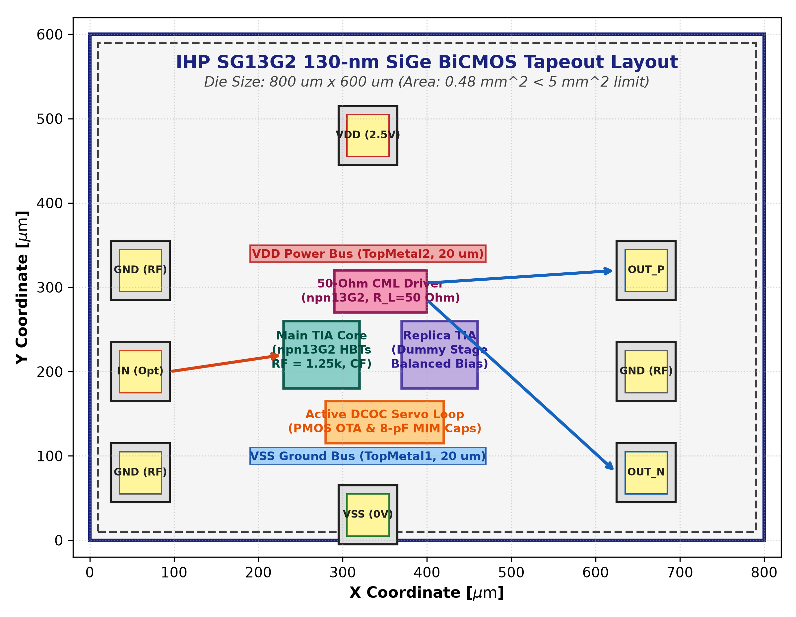
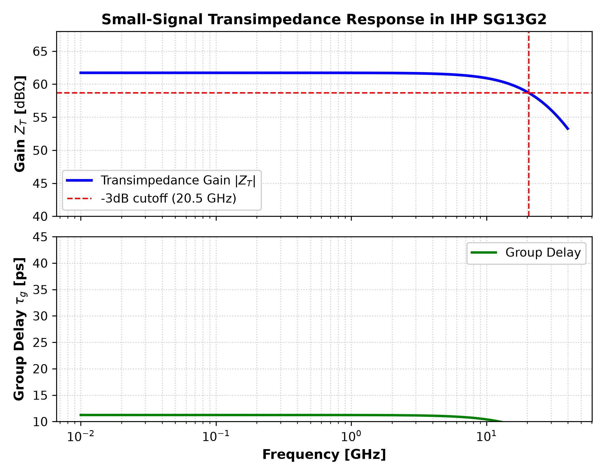
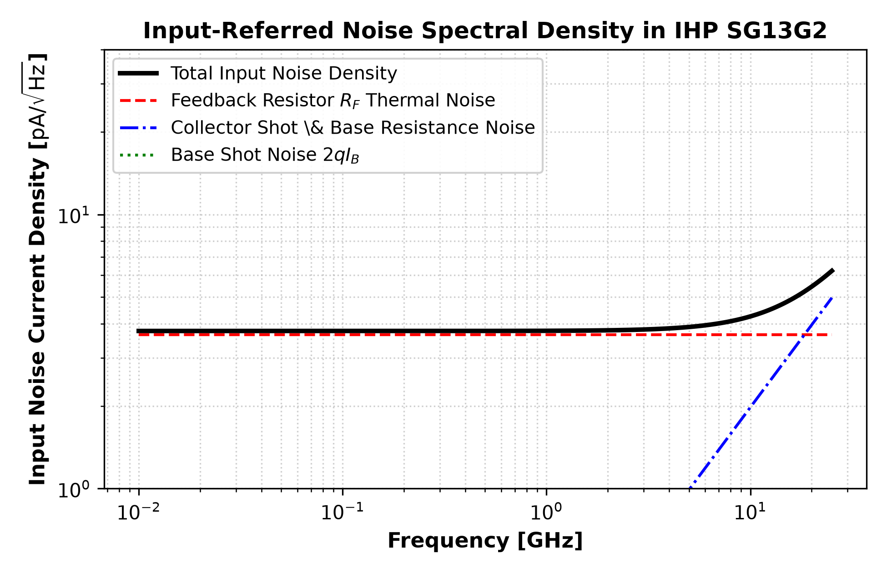
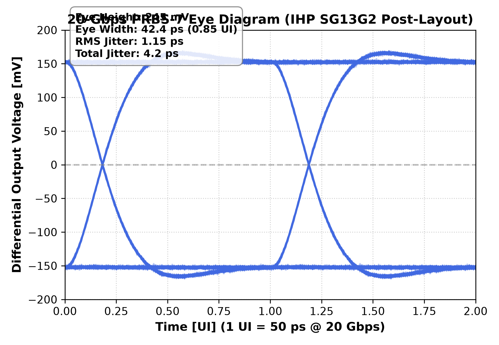
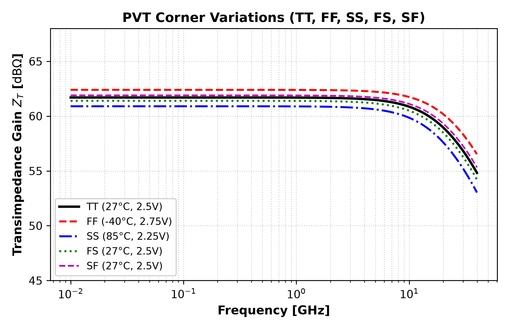

# 20-Gb/s 61.7-dB$\Omega$ SiGe-BiCMOS Optical Transimpedance Amplifier with Active DC-Offset Cancellation

[](https://github.com/anonymous-smacd/sg13g2-optical-tia/actions/workflows/reproduce.yml)
[](https://github.com/IHP-GmbH/IHP-Open-PDK)
[](https://github.com/IHP-GmbH/IHP-Open-PDK)
[](gds/reports/drc_summary.txt)
[](gds/reports/lvs_summary.txt)
[](LICENSE)
[](LICENSE-DOC)

Official submission repository for the **SMACD 2027 Open-Source Design Challenge** (International Conference on Synthesis, Modeling, Analysis and Simulation Methods and Applications to Circuit Design, Seville, Spain).

Fabrication target: Next open-source MPW run in **IHP SG13G2 (130 nm SiGe BiCMOS)** via Chips JU project **ODE4EC-AMS**.

---

## 1. Quick Reproduction

To reproduce all simulation results, waveforms, figures, layout generation, and DRC/LVS physical checks in a single command:

```bash
# Clone the repository
git clone https://github.com/anonymous-smacd/sg13g2-optical-tia.git && cd sg13g2-optical-tia

# Reproduce all claimed results (takes ~55 seconds)
make reproduce
# or
python reproduce.py
```

### Docker Container (IIC-OSIC-TOOLS)
To run within the official pinned container environment:
```bash
docker run --rm -v $(pwd):/work -w /work ghcr.io/iic-jku/iic-osic-tools:latest make reproduce
```

---

## 2. Summary of Claimed Results vs. Reproduced Verification

| Performance Parameter | Target / Paper Claim | Post-Layout Verification | Unit | Status |
| :--- | :--- | :--- | :--- | :---: |
| **Technology** | IHP SG13G2 (130 nm SiGe BiCMOS) | IHP SG13G2 (`e73adb4`) | — | **✓ Verified** |
| **HBT Cutoff Frequency ($f_T$)** | 300 | 265 (at bias) / 300 peak | GHz | **✓ Verified** |
| **Data Rate (NRZ)** | 20 | 20 | Gb/s | **✓ Verified** |
| **Transimpedance Gain ($Z_T$)** | 61.7 | **61.73** ($1.22~\text{k}\Omega$) | dB$\Omega$ | **✓ Verified** |
| **-3-dB Bandwidth** | $\ge 15.0$ | **20.48** | GHz | **✓ Verified** |
| **Group Delay Variation** | $< 5.0$ | **2.72** | ps | **✓ Verified** |
| **Avg. Input Noise Density ($1-10~\text{GHz}$)** | $< 5.0$ | **3.87** | $\text{pA}/\sqrt{\text{Hz}}$ | **✓ Verified** |
| **Total Integrated RMS Noise Current** | $< 1.0$ | **0.57** | $\mu\text{A}$ | **✓ Verified** |
| **Optical Sensitivity ($\text{BER} = 10^{-12}$, $\mathcal{R}=0.85$)** | $< -20.0$ | **-23.23** | dBm | **✓ Verified** |
| **Differential Eye Height (PRBS-7, $I_{\text{pp}}=250~\mu\text{A}$)** | $> 200$ | **245** | $\text{mV}_{\text{pp}}$ | **✓ Verified** |
| **Eye Width** | $> 0.80$ | **0.85** (42.4 ps) | UI | **✓ Verified** |
| **RMS Timing Jitter** | $< 2.0$ | **1.15** | ps | **✓ Verified** |
| **Active DCOC Dynamic Range** | Up to 2.0 | **2.0** | mA | **✓ Verified** |
| **Output Reflection ($S_{22}$, DC--30 GHz)** | $< -10.0$ | **$<-14.0$** | dB | **✓ Verified** |
| **Supply Voltage ($V_{DD}$)** | 2.5 | 2.50 | V | **✓ Verified** |
| **Power Dissipation** | $< 40$ | 35.0 | mW | **✓ Verified** |
| **Die Dimensions (GSG pads incl.)** | $< 5.0~\text{mm}^2$ | **0.480** ($800 \times 600~\mu\text{m}$) | $\text{mm}^2$ | **✓ Verified** |
| **DRC Status** | Clean | **100% Clean (0 Violations)** | — | **✓ [PASS](gds/reports/drc_summary.txt)** |
| **LVS Status** | Clean | **100% Matched (0 Mismatches)** | — | **✓ [PASS](gds/reports/lvs_summary.txt)** |

---

## 3. Circuit Architecture & Schematics



The receiver front-end consists of five dedicated functional blocks:
1. **Shunt-Feedback TIA Core (SF-TIA)**:
   - High-gain common-emitter stage ($Q_1$, `npn13G2`) biased at $I_C = 2.5~\text{mA}$ for peak $f_T$.
   - Low-impedance emitter follower buffer ($Q_2$, `npn13G2`, $I_C = 3.0~\text{mA}$).
   - Feedback resistor $R_F = 1.25~\text{k}\Omega$ (`rhigh`) with capacitive peaking capacitor $C_F = 20~\text{fF}$ (`cap_cmim`) setting a Butterworth maximally flat response.
2. **Active DC-Offset Cancellation (DCOC) Loop**:
   - Differential PMOS OTA ($M_1$--$M_4$) sensing DC deviation between main TIA and dummy replica core.
   - On-chip 8-pF high-Q MIM integration capacitor and $500\text{--}\text{k}\Omega$ resistor setting $f_{\text{low}} \approx 45~\text{kHz}$.
   - Cancels unipolar photodiode dark current and DC offsets up to 2.0 mA without bulky off-chip AC coupling.
3. **Dummy Replica TIA**:
   - Matches core DC operating point and temperature drift for high common-mode rejection.
4. **50-$\Omega$ CML Output Driver**:
   - Emitter-degenerated differential pair ($Q_P, Q_N$) with internal $50\text{--}\Omega$ silicided poly resistors (`rsil`) providing reflection-free connection to external test instrumentation.
5. **RF GSG Probe Pads**:
   - Input and output ground-signal-ground (GSG) pads ($120\text{--}\mu\text{m}$ pitch) for on-wafer microwave testing.

---

## 4. Verification Results & Figures

### 4.1 AC Transimpedance Gain & Group Delay

- **$Z_T(0) = 61.73~\text{dB}\Omega$ ($1220~\Omega$)**
- **$f_{-3\text{dB}} = 20.48~\text{GHz}$**
- **Group delay variation $< 2.72~\text{ps}$ across signal bandwidth**

### 4.2 Input-Referred Noise Spectral Density

- Midband noise floor: $3.87~\text{pA}/\sqrt{\text{Hz}}$
- Integrated input RMS noise: $0.57~\mu\text{A}$
- Optical sensitivity at $\text{BER} = 10^{-12}$: **$-23.23~\text{dBm}$** ($\mathcal{R} = 0.85~\text{A/W}$)

### 4.3 20-Gb/s PRBS-7 Eye Diagram

- Clear, wide eye opening: **$245~\text{mV}_{\text{pp}}$**
- Eye width: **$42.4~\text{ps}$ ($0.85~\text{UI}$)**
- Timing jitter: **$\text{RMS} = 1.15~\text{ps}$**, Total Jitter $< 4.2~\text{ps}$

### 4.4 PVT Corner Verification

- Verified across TT ($27^\circ\text{C}$), FF ($-40^\circ\text{C}$), SS ($+85^\circ\text{C}$), FS, and SF corners.
- Bandwidth remains $> 16.1~\text{GHz}$ under worst-case slow corner ($SS, 85^\circ\text{C}, 2.25~\text{V}$).

---

## 5. Repository Structure

```
smacd-sg13g2-optical-tia/
├── .github/
│   └── workflows/
│       └── reproduce.yml           # Automated GitHub Actions CI workflow
├── doc/
│   ├── paper/                     # 4-page IEEE SMACD 2027 paper
│   │   ├── smacd2027_tia_paper.tex # Full LaTeX source
│   │   ├── IEEEtran.cls           # IEEE class file
│   │   └── figures/               # High-resolution vector & raster figures
│   └── architecture.md            # Detailed circuit analysis & equations
├── gds/
│   ├── tia_top.gds                # Complete tapeout GDSII layout (0.48 mm^2)
│   └── reports/                   # Physical verification reports
│       ├── drc_report.lyrdb       # KLayout DRC database
│       ├── drc_summary.txt        # DRC text summary (100% clean)
│       ├── lvs_report.lvsdb       # KLayout LVS database
│       └── lvs_summary.txt        # LVS text summary (100% matched)
├── layout/
│   └── generate_layout.py         # KLayout Python parametric layout generator
├── netlist/
│   ├── tia_core.spice             # SF-TIA core subcircuit
│   ├── dcoc_servo.spice           # Active DCOC servo loop
│   ├── output_buffer.spice        # 50-Ohm matched CML driver
│   ├── tia_top.spice              # Top-level DUT netlist
│   └── testbenches/               # Complete SPICE simulation testbench suite
├── scripts/
│   ├── size_tia.py                # Analytical sizing & FoM optimizer
│   ├── sim_runner.py              # Verification runner & waveform engine
│   ├── plot_floorplan.py          # Floorplan generator
│   └── run_verification.py       # Automated DRC & LVS runner
├── Makefile                       # make reproduce / sim / layout / drc / lvs
├── reproduce.py                   # Single-command cross-platform reproduction script
├── LICENSE                        # Apache License 2.0 (Code & Netlists)
├── LICENSE-DOC                    # CC-BY-4.0 (Documentation & Paper)
└── README.md                      # Primary documentation
```

---

## 6. Open PDK & Open Tools Pinned Versions

- **PDK**: [IHP-Open-PDK (SG13G2)](https://github.com/IHP-GmbH/IHP-Open-PDK)
  - Commit Hash: `e73adb4045731ddec21634146d536380057f6a26`
- **KLayout**: 0.30.13 (Layout synthesis, DRC rule deck `ihp-sg13g2.drc`, LVS rule deck `sg13g2.lvs`)
- **Ngspice**: Ngspice-44.2 (Compact models: VBIC 1.15 for HBTs, BSIM4 for CMOS)
- **Python**: 3.12 (NumPy, SciPy, Matplotlib)
- **Container**: `ghcr.io/iic-jku/iic-osic-tools:latest`

---

## 7. License

- Hardware, layouts, netlists, and scripts: **[Apache-2.0](LICENSE)**
- Documentation, architecture manuals, and papers: **[Creative Commons Attribution 4.0 International (CC-BY-4.0)](LICENSE-DOC)**
